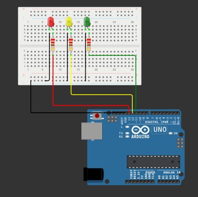
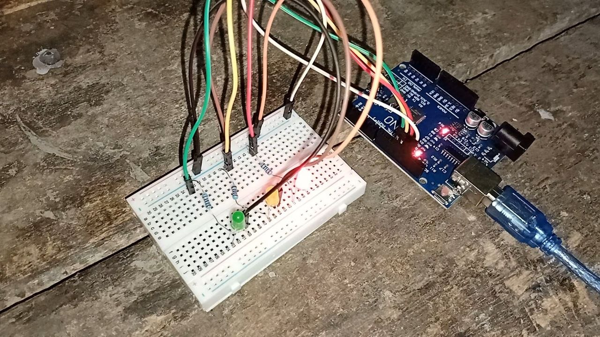

# 🚦 Projet Arduino - Feux de signalisation

Projet de programmation sur carte Arduino UNO R3 : gestion et contrôle des sorties numériques pour simuler le fonctionnement d'un système de feux de signalisation.

---

## 📸 Aperçu et Démonstration

| Schéma électrique | Montage réel | 
| :---: | :---: | 
|  |  | 

---

## 🧰 Matériel utilisé

* **1x** Carte Arduino UNO R3 (avec câble USB)
* **1x** Breadboard (plaque d'essai)
* **3x** LEDs (rouge, jaune, verte)
* **3x** Résistances de 220 Ω (ou 330 Ω)
* **7x** Câbles de connexion DuPont (mâle-mâle)

---

## 🔌 Câblage et Montage

1. Connecter l'**Anode** (patte longue, `+`) de la LED rouge à la **broche numérique 13** (`Pin 13`) de l'Arduino en passant par une résistance de **220 Ω**.
2. Connecter l'**Anode** (patte longue, `+`) de la LED jaune à la **broche numérique 12** (`Pin 12`) de l'Arduino en passant par une résistance de **220 Ω**.
3. Connecter l'**Anode** (patte longue, `+`) de la LED verte à la **broche numérique 11** (`Pin 11`) de l'Arduino en passant par une résistance de **220 Ω**.
4. Connecter la **Cathode** (patte courte, `-`) de chaque LED au rail d'alimentation négatif (masse) de la **Breadboard**.
5. Relier le rail d'alimentation négatif de la **Breadboard** à l'une des broches **GND** de l'Arduino à l'aide d'un câble DuPont.

### Récapitulatif du circuit :
* **Pin 13** ➔ Résistance 220 Ω ➔ Anode (`+`) LED rouge
* **Pin 12** ➔ Résistance 220 Ω ➔ Anode (`+`) LED jaune
* **Pin 11** ➔ Résistance 220 Ω ➔ Anode (`+`) LED verte
* **Cathodes des LEDs** ➔ Rail d'alimentation négatif ➔ **GND** (Arduino)

---

## 💻 Code Source

Le code source du projet est disponible dans le fichier [`traffic-light-controller.ino`](traffic-light-controller.ino).

---

## 🚀 Comment tester le projet ?

### Option 1 : Simulation en ligne (Wokwi)
Vous pouvez tester et simuler le montage directement dans votre navigateur sans matériel grâce à Wokwi :
👉 **[Tester le projet sur Wokwi](https://wokwi.com/projects/476092304611350529)**

### Option 2 : Sur le matériel réel
1. Connecter la carte Arduino UNO à l'ordinateur via le câble USB.
2. Ouvrir le logiciel **Arduino IDE**.
3. Sélectionner la carte **Arduino Uno** et le port COM approprié.
4. Téléverser le fichier `traffic-light-controller.ino` sur la carte.